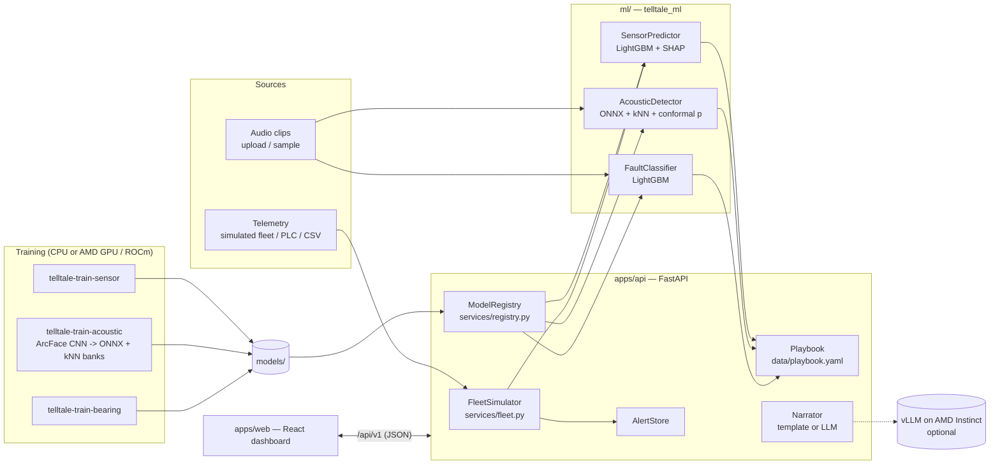

# Architecture

## Key decisions

| Decision | Why |
|---|---|
| **One Python package (`telltale_ml`) shared by training and serving** | Feature engineering lives in one place (`sensor/features.py`, `acoustic/features.py`), so there is no skew between training and serving. |
| **LightGBM for tabular data and the bearing classifier** | Strong on small tabular datasets, trains in seconds, and gives exact per-prediction SHAP values via `pred_contrib=True` with no extra dependency. Models are saved as **text**, not pickle. |
| **Learn from normal sounds only** | Real factories have plenty of normal audio and very few labelled faults. v2 trains a CNN to tell recording *conditions* apart (ArcFace loss) and scores clips by nearest-neighbour distance to normal clips, combined with classical spectra. That's the DCASE 2021+ approach. The DCASE autoencoder baseline remains available for comparison (`method: autoencoder`). |
| **Score without knowing the section** | Uploaded clips don't say which machine/section they came from, so the scorer takes the minimum over all (section, domain) banks, and evaluation is done the same way. |
| **Conformal calibration** | Raw anomaly scores have no units. A calibration hold-out of normal clips turns them into p-values ("only 2% of normal recordings sound this unusual") with a finite-sample false-alarm guarantee. For bearings, the same idea gives prediction sets ("inner race or ball"). |
| **Torch for training → ONNX for serving** | Training runs on AMD GPUs through ROCm PyTorch. The API image needs only `onnxruntime` (no torch), which keeps it small and fast. Normalisation is built into the ONNX graph. |
| **Thresholds chosen on validation, reported on test** | Sensor: the max-F1 threshold on the validation split. Sound: a percentile of held-out *normal* scores. No threshold is ever tuned on test data. |
| **Playbook as YAML** | Maintenance engineers can edit inspection steps without touching code. |
| **The LLM only rephrases** | Scores and recommendations are deterministic. The optional LLM turns them into a briefing and falls back to a template. It can never invent a risk score. |
| **In-memory state (alerts, fleet)** | Fine for a hackathon. `AlertStore` and `FleetSimulator` have narrow interfaces, so a DB- or MQTT-backed version can replace them. |

## Request flow: `GET /api/v1/machines/{id}`

1. `FleetSimulator.tick()` runs every `TELLTALE_SIMULATOR_INTERVAL_S` seconds. It generates the next reading for every machine and scores them all in one batch with `SensorPredictor.assess`. It stores the history (240 points) and raises an alert when a machine enters the high-risk band.
2. The route returns the latest assessment plus `Playbook.for_sensor(...)` recommendations and the history.
3. The web app polls every 3 s with TanStack Query.

## Risk bands (sensor)

- **high** ≥ the failure model's max-F1 threshold on validation data. This is the alert threshold.
- **medium** ≥ `medium_fraction` × high (default 0.4). This is an early-warning band.
- Both values are in `models/sensor/metadata.json` → `risk_thresholds`.

## Sound status (v2)

- `score` = weighted mean of the CNN branch and the classical branch. Each branch is the nearest-neighbour distance to the closest normal (section, domain) bank, z-normalised by that section's leave-one-out distances.
- `p_value` = share of held-out normal clips scoring at least as high (split conformal). `unusual_percentile` = 100 × (1 − p).
- **anomalous** if p ≤ 0.05 (= the 95th percentile of normal scores); **watch** if p ≤ 0.15.
- `severity` = log(p) / log(0.05): 1.0 exactly at the alert level, about 2 for the most unusual clips the calibration can resolve.
- The UI also shows a sliding-window timeline (~2 s windows: *when* it sounded odd) and the per-band z-score against the normal reference spectrum (*which frequencies* differ).
- Legacy autoencoder models (`scorer: autoencoder`) still load. They use reconstruction error with the old threshold rules.
